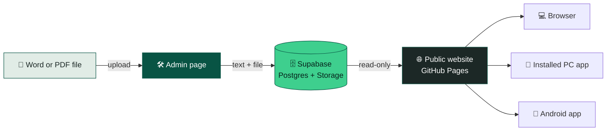

<div align="center">

<picture>
  <source media="(prefers-color-scheme: dark)" srcset="logo-white.svg">
  
</picture>

# മലയാളം ഓപ്ഷണൽ
### **malayalamoptional** · Study Library for UPSC Malayalam Optional

*Notes, poems and articles for Paper I & Paper II. Clean to read, easy to study, fast on every device.*

<br>

[](https://malayalamupsc.github.io/malayalamoptional/)
[](https://github.com/malayalamupsc/malayalamoptional/releases/tag/apk-latest)
[](https://malayalamupsc.github.io/malayalamoptional/)


</div>

---

## 📖 What is this?

**malayalamoptional** is a study website for Malayalam Optional aspirants. Articles are written once in a Word file or in the built-in editor, and readers get a calm, fast reading page with their own theme, their own progress and a full-screen app experience.

> 🌿 **Palette:** Forest `#085444` · Cream `#FDFCFA` · Charcoal `#1C2826` · Sage `#E1ECE6`

---

## ✨ Features

### 👩‍🎓 For readers

| | Feature | What you get |
|---|---|---|
| 🎨 | **Three themes** | ☀️ Day, 🌙 Dark (default) and 👁️ Eye protection, a warm paper tone that is gentle at night |
| 📚 | **Collections** | Articles grouped into collection cards, such as a poet or a work |
| 🔎 | **Search and filters** | Search by title, filter by **Paper I**, **Paper II** or **General** |
| 📈 | **Reading progress bar** | A thin bar at the top shows how far you have read |
| 🔖 | **Continue where you left off** | Reopen an article and jump back to your spot. Lists show *"45% read"* or *"Read ✓"* |
| 🖋️ | **Malayalam typography** | Noto Serif Malayalam, bold for titles and cards, readable regular weight for long notes |
| 💬 | **Poem quotes** | Verses shown in a soft quote style with large quote marks |
| ⚡ | **Instant loading** | Pages appear straight away from your last visit and refresh quietly in the background |
| 🖥️ | **Full screen** | Goes full screen on your first click, with a button to toggle it |
| 📥 | **Downloads** | Original `.docx` file for each article, and PDF viewing |

### ✍️ For the admin

| | Feature | What you get |
|---|---|---|
| 🔐 | **Secure login** | Only your email can write. This is enforced by database rules, not by hiding a page |
| ⬆️ | **Upload articles** | Drop in `.docx` or PDF files, pick a Paper and a collection |
| ✏️ | **Pencil edit button** | Edit any article right on the page |
| 🔠 | **Headings** | `¶` `H1` `H2` `H3` buttons. Each line is either a heading or a paragraph, never mixed, and same level means same size |
| **B** *I* <u>U</u> | **Text styles** | Bold, italic and underline |
| ❝ | **Poem quote tool** | Select verse lines and turn them into a quote block, like a pull-quote |
| ¶＋ | **Spacing** | Add or remove empty lines wherever you need space |
| ↶ ↷ | **Undo and redo** | With Save and Cancel, and a warning if you leave with unsaved changes |
| 🗂️ | **Collections editor** | Create collection cards with an image, a description and a button text |

### 📱 Apps

| Platform | How |
|---|---|
| 💻 **Windows, Mac, Linux** | Open the site in Chrome or Edge and click **Install app**. It opens in its own window, full screen |
| 🤖 **Android** | Download the APK from [Releases](https://github.com/malayalamupsc/malayalamoptional/releases/tag/apk-latest). It is a native app shell around the live site |
| 🍎 **iPhone** | Safari → Share → **Add to Home Screen** |

---

## 🧭 How it works



- **Content** lives in Supabase: text in Postgres, original files in Storage.
- **Visitors can only read.** Only the admin email can add, edit or delete.
- **The site is static**, so there is nothing to build. Push to GitHub and it is live.

---

## 🧰 Tech stack

| Layer | Used |
|---|---|
| 🌐 Front end | Plain HTML, CSS and JavaScript. No framework, no build step |
| 🗄️ Database | [Supabase](https://supabase.com): Postgres, Auth, Storage and Row Level Security |
| 🧼 Safety | [DOMPurify](https://github.com/cure53/DOMPurify) cleans article HTML |
| 📝 Word import | [mammoth.js](https://github.com/mwilliamson/mammoth.js) converts `.docx` to HTML |
| 🔤 Fonts | Inter and Noto Serif Malayalam (Google Fonts) |
| 🚀 Hosting | GitHub Pages |
| 🤖 Android | Java WebView app, built automatically by GitHub Actions |

---

## 🗂️ Project structure

```text
malayalamoptional/
├── index.html              # Public site: list, collections, article reader, editor
├── admin.html              # Admin: login, upload, collections
├── config.js               # Supabase URL + public key (safe to expose)
├── card.js · card.css      # Collection cards
├── style.css               # Base styles
├── public.css              # Public site design
├── admin.css               # Admin design
├── theme.js · theme.css    # Day / Dark / Eye themes, logo colours, Malayalam font styling
├── progress.js             # Reading progress + continue where you left off
├── fullscreen.js           # Full screen on first click + button
├── pwa.js · sw.js          # Install as app
├── manifest.webmanifest    # App name, icons, full-screen display
├── supabase.sql            # Database setup (run once)
├── supabase-folders.sql    # Collections setup
├── favicon.svg / .png      # Browser tab icon
├── logo-black.svg · logo-white.svg
├── icon-192-v4.png · icon-512-v4.png
├── apple-touch-icon.png
├── pattern.webp            # Background pattern
├── android/                # Android app project (WebView)
└── .github/workflows/
    └── build-apk.yml       # Builds the Android APK automatically
```

---

## 🚀 Setup

<details>
<summary><b>1️⃣ Create the Supabase project</b></summary>

1. Create a project at [supabase.com](https://supabase.com).
2. Open **SQL Editor**, paste `supabase.sql`, replace `YOUR_ADMIN_EMAIL` with your email (every place it appears) and run it.
3. Then run `supabase-folders.sql` for collections.

</details>

<details>
<summary><b>2️⃣ Create the admin user</b></summary>

1. **Authentication → Users → Add user**: your email and a strong password, with auto-confirm ticked.
2. **Authentication → Sign In / Providers**: turn **off** "Allow new users to sign up".

</details>

<details>
<summary><b>3️⃣ Add your keys</b></summary>

1. **Project Settings → API**.
2. Put the **Project URL** and the **anon / publishable key** in `config.js`.
3. ⚠️ Never put the `service_role` key anywhere on the site.

</details>

<details>
<summary><b>4️⃣ Publish on GitHub Pages</b></summary>

1. Push all files to a GitHub repo.
2. **Settings → Pages → Deploy from branch** `main` / root.
3. Your site appears at `https://USERNAME.github.io/REPO/`.
4. Optional: add a custom domain under Pages.

</details>

<details>
<summary><b>5️⃣ Start publishing</b></summary>

Open `/admin.html`, log in and upload `.docx` files. There is no link to it from the public pages, and only the admin email can save changes.

</details>

---

## 🤖 Android app (APK)

The Android app is built for you by GitHub. You never need Android Studio.

1. Open the **Actions** tab → **Build Android app (APK)** → **Run workflow**.
2. Wait about 3 to 5 minutes for the green tick.
3. Open **Releases → Android app (APK)** and download `malayalamoptional.apk` on your phone.
4. Install it. Allow "install from this source" when Android asks.

**The app:** opens full screen, remembers your theme, progress and login, handles uploads and downloads, opens other websites in the browser and shows a friendly *Try again* screen when offline.

> 🔁 The app loads the live site, so **site updates need no new APK**. Rebuild only when you change something inside `android/`.
> 🌐 Using a custom domain? Add a repo variable named `SITE_URL` (Settings → Secrets and variables → Actions → Variables).

---

## 🎨 Themes

| Theme | Look | Logo |
|---|---|---|
| ☀️ **Day** | Cream and white, forest green accents | Black |
| 🌙 **Dark** *(default)* | Deep charcoal green, soft white text | White |
| 👁️ **Eye protection** | Warm paper tones, low blue light, softer contrast | Dark brown |

Your choice is remembered on that device.

---

## 🛠️ Customising

| I want to change… | Edit |
|---|---|
| Categories (Paper I, Paper II…) | `CATEGORIES` in `config.js` |
| Colours of a theme | `theme.css` and the variables at the top of `public.css` / `admin.css` |
| Heading sizes | the heading rules near the end of `public.css` |
| Logo | `logo-black.svg`, `logo-white.svg`, `favicon.svg` and the inline logo in the header of `index.html` / `admin.html` |
| App icon on PC | `icon-192-v4.png`, `icon-512-v4.png`. If you rename them, update `manifest.webmanifest` too |

---

## 🔒 Security

- 🛡️ **Row Level Security** in Postgres: everyone can read, only your email can write.
- 🚫 New sign-ups are switched off.
- 🧼 Article HTML is cleaned with DOMPurify before it is shown or saved.
- 🔑 Only the public (anon) key is used in the browser.

---

## 🗺️ Ideas for the future

- [ ] Bookmarks and a Saved list
- [ ] Highlights and personal notes
- [ ] Font size and line spacing controls
- [ ] Search inside article text
- [ ] Previous and next article inside a collection
- [ ] Quizzes and flashcards
- [ ] Read-aloud for poems
- [ ] Draft and publish for the admin

---

<div align="center">

**Made with 💚 for Malayalam Optional aspirants**

<sub>Studying hard? Take a break, rest your eyes and switch to 👁️ Eye protection.</sub>

</div>
