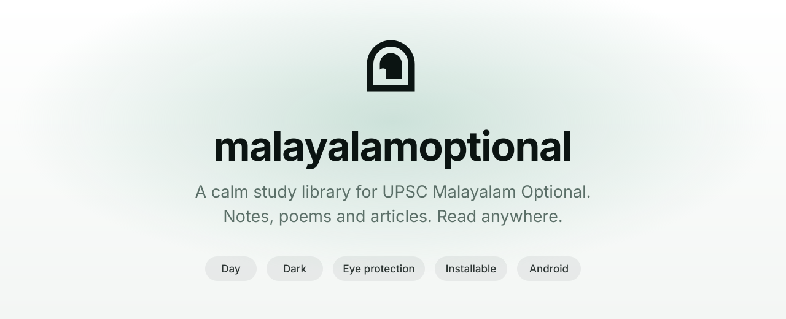
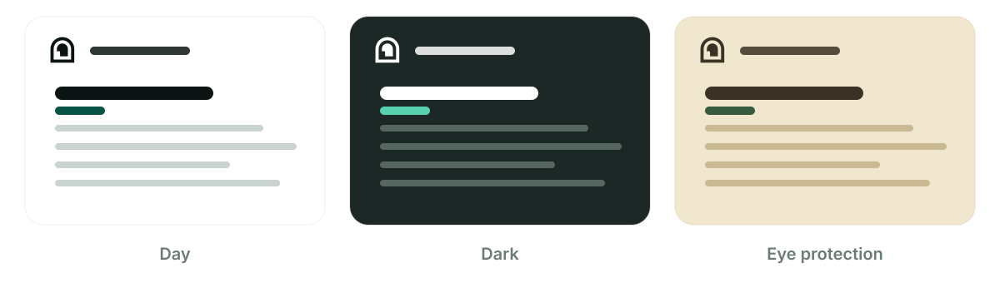
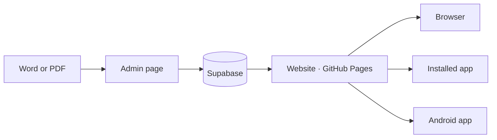

<div align="center">

<picture>
  <source media="(prefers-color-scheme: dark)" srcset="assets/banner-dark.svg">
  
</picture>

<br>

**[Open the website](https://malayalamupsc.github.io/malayalamoptional/)**  &nbsp;·&nbsp;  **[Get the Android app](https://github.com/malayalamupsc/malayalamoptional/releases/tag/apk-latest)**

<br>

</div>

## Designed for focus.

malayalamoptional is a study library for Malayalam Optional aspirants. Every article opens in a quiet reading page that remembers where you stopped, adapts to your eyes, and feels at home on a phone, a laptop or a full-screen app.

There is no account to create and nothing to set up. Open it, and read.

<br>

## Three themes. One for every hour.

<div align="center">
  
</div>

<br>

**Day** is crisp and bright. **Dark** is the default, deep and easy at night. **Eye protection** uses warm paper tones with less blue light for long study sessions. Your choice is remembered on every device you use.

<br>

## Made for reading

<table>
<tr>
<td width="33%" valign="top">

**Pick up where you left off**<br>
A thin progress bar follows you down the page. Come back later and jump straight to your spot. Lists show *45% read* or *Read*.

</td>
<td width="33%" valign="top">

**Find anything fast**<br>
Search by title. Filter by Paper I, Paper II or General. Browse collections as clean cards.

</td>
<td width="33%" valign="top">

**Beautiful Malayalam**<br>
Set in Noto Serif Malayalam. Bold for titles, a comfortable weight for long notes, and poems shown as elegant quotes.

</td>
</tr>
<tr>
<td width="33%" valign="top">

**Instant**<br>
Pages appear immediately from your last visit, then quietly refresh in the background.

</td>
<td width="33%" valign="top">

**Full screen**<br>
One click and the browser chrome disappears. One more click and it comes back.

</td>
<td width="33%" valign="top">

**Take it with you**<br>
Download the original Word file for any article, or read PDFs right on the page.

</td>
</tr>
</table>

<br>

## Made for writing

Edit any article in place. Tap the pencil, and the page becomes your editor.

| | |
|---|---|
| **Headings** | Choose Normal, H1, H2 or H3. A line is either a heading or a paragraph, never both. Same level, same size. |
| **Text** | Bold, italic and underline. |
| **Poem quotes** | Select the lines of a verse and turn them into a refined quote with large quote marks. |
| **Spacing** | Add or remove an empty line wherever the text needs room to breathe. |
| **Safety** | Undo, redo, Save and Cancel. A warning appears before you leave with unsaved changes. |
| **Upload** | Drop in a `.docx` or PDF, choose a paper and a collection, and publish. |

Only the admin account can save. This is enforced by the database, not by hiding a page.

<br>

## An app on every screen

| | | |
|---|---|---|
| **Windows · Mac · Linux** | Open the site in Chrome or Edge and choose **Install app**. It opens in its own window, full screen. | |
| **Android** | Download the APK from [Releases](https://github.com/malayalamupsc/malayalamoptional/releases/tag/apk-latest). It remembers your theme, progress and login. | |
| **iPhone and iPad** | In Safari, tap Share, then **Add to Home Screen**. | |

<br>

## How it works



Articles live in [Supabase](https://supabase.com): text in Postgres, original files in Storage. Visitors can only read. The site itself is plain HTML, CSS and JavaScript, so there is no build step. Push to GitHub and it is live.

| | |
|---|---|
| **Front end** | HTML, CSS, JavaScript |
| **Data** | Supabase Postgres, Auth and Storage, with Row Level Security |
| **Word import** | [mammoth.js](https://github.com/mwilliamson/mammoth.js) |
| **Safety** | [DOMPurify](https://github.com/cure53/DOMPurify) cleans every article |
| **Hosting** | GitHub Pages |
| **Android** | A Java WebView app, built by GitHub Actions |

<br>

## Get started

<details>
<summary><b>1. Create the database</b></summary>

<br>

1. Create a project at [supabase.com](https://supabase.com).
2. Open **SQL Editor**, paste `supabase.sql`, replace `YOUR_ADMIN_EMAIL` with your email everywhere it appears, and run it.
3. Run `supabase-folders.sql` to add collections.

</details>

<details>
<summary><b>2. Create the admin account</b></summary>

<br>

1. Go to **Authentication → Users → Add user**. Use your email and a strong password, and tick auto-confirm.
2. Under **Authentication → Sign In / Providers**, turn **off** "Allow new users to sign up".

</details>

<details>
<summary><b>3. Add your keys</b></summary>

<br>

1. Open **Project Settings → API**.
2. Put the **Project URL** and the **anon (publishable) key** in `config.js`.
3. Never place the `service_role` key on the site.

</details>

<details>
<summary><b>4. Publish</b></summary>

<br>

1. Push all files to a GitHub repository.
2. Go to **Settings → Pages**, choose **Deploy from branch**, pick `main` and the root folder.
3. Your site appears at `https://USERNAME.github.io/REPO/`. A custom domain is optional.

</details>

<details>
<summary><b>5. Start writing</b></summary>

<br>

Open `/admin.html`, sign in and upload your first `.docx`. There is no link to the admin page from the public site.

</details>

<br>

## Build the Android app

You never need Android Studio. GitHub builds it for you.

1. Open **Actions → Build Android app (APK) → Run workflow**.
2. Wait three to five minutes for the green tick.
3. Open **Releases → Android app (APK)** on your phone and download `malayalamoptional.apk`.
4. Install it. Android will ask once to allow installs from this source.

The app loads the live site, so website updates never need a new APK. Rebuild only when you change something inside `android/`. On a custom domain, add a repository variable named `SITE_URL`.

<br>

## Make it yours

| To change | Edit |
|---|---|
| Categories | `CATEGORIES` in `config.js` |
| Theme colours | `theme.css`, and the variables at the top of `public.css` and `admin.css` |
| Heading sizes | The heading rules near the end of `public.css` |
| Logo | `logo-day.svg`, `logo-night.svg`, `logo-eye.svg`, and `favicon.svg` |
| App icon | `icon-192-v4.png` and `icon-512-v4.png`. If you rename them, update `manifest.webmanifest` |

<details>
<summary><b>Project structure</b></summary>

<br>

```text
malayalamoptional/
├── index.html · admin.html       Public site and admin
├── config.js                     Supabase URL and public key
├── style.css · public.css        Design
├── admin.css · card.css          Admin design and collection cards
├── theme.js · theme.css          Day, Dark and Eye themes
├── progress.js                   Reading progress and resume
├── fullscreen.js                 Full screen
├── pwa.js · sw.js                Install as an app
├── manifest.webmanifest          App name, icons, full-screen display
├── supabase.sql                  Database setup
├── supabase-folders.sql          Collections setup
├── logo-day.svg · logo-night.svg · logo-eye.svg · favicon.svg
├── icon-192-v4.png · icon-512-v4.png · apple-touch-icon.png
├── assets/                       README images
├── android/                      Android app project
└── .github/workflows/            Builds the APK
```

</details>

<br>

## Privacy and security

- Everyone can read. Only your email can write, enforced by Row Level Security in Postgres.
- New sign-ups are switched off.
- Article HTML is cleaned before it is shown or saved.
- Only the public anon key is used in the browser.
- Reading progress and theme choice stay in your own browser.

<br>

<div align="center">

<sub>Made with care for Malayalam Optional aspirants.</sub>

</div>
